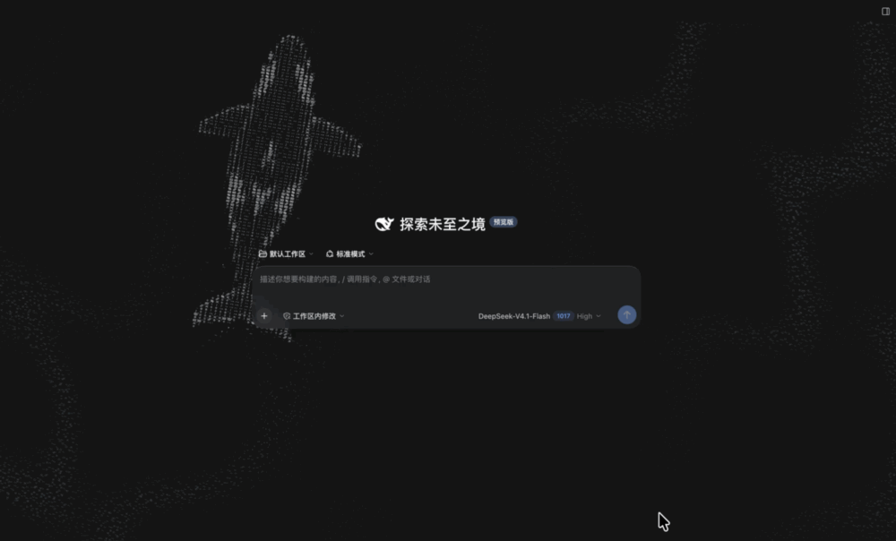
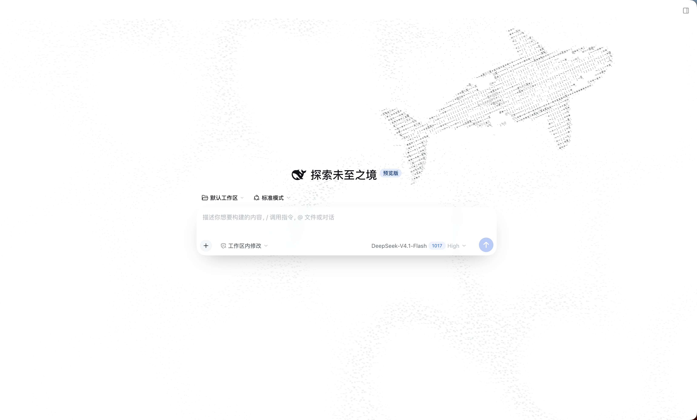
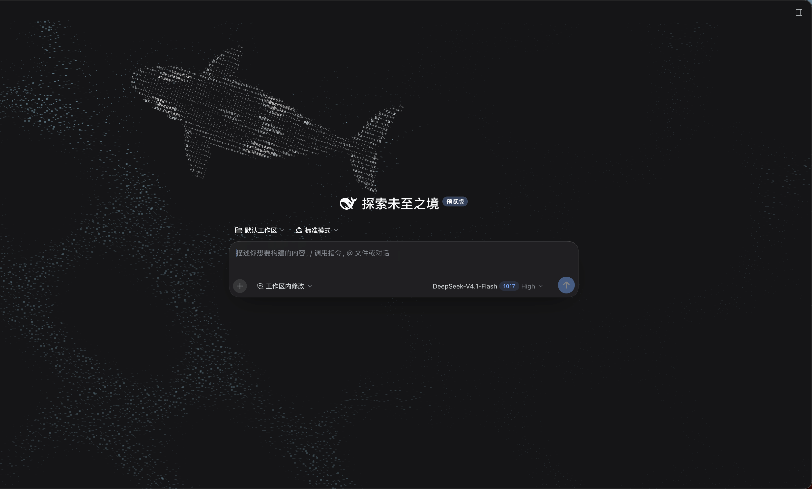

# ASCII Orca Cruise

[中文](README.md) | English

**Let an ASCII orca swim into your DeepSeek Harness.**

A dynamic pure-ASCII background of a cruising orca, active only on the new-session page. After the first prompt is sent, the orca dives Into the Unknown.



[Watch the full recording](assets/demo.mp4)

| Light mode | Dark mode |
| --- | --- |
|  |  |

Demo environment: DeepSeek Harness `0.2.1-rc.2` on macOS.

## Install

In DeepSeek Harness Desktop, open **Plugins → Add plugin** and enter:

```text
github:sherl98/dsh-orca-ocean
```

For Web / CLI:

```sh
dsh plugin --profile web add github:sherl98/dsh-orca-ocean
```

Enable or restart as prompted, then open a new session. Adapts to light and dark mode and respects your system's reduced-motion setting.

To uninstall, remove it from the Plugins page or run `dsh plugin --profile web remove @sherl98/dsh-orca-ocean`.

## Development

After editing `client.template.js` or `mask.json`, run `npm run build` to regenerate the bundled `client.js`. No extra runtime dependencies are needed.

## Thanks

Inspired by [stackedlol/ascii-sharks](https://github.com/stackedlol/ascii-sharks).

## License

[MIT](LICENSE) © 2026 sherl98
